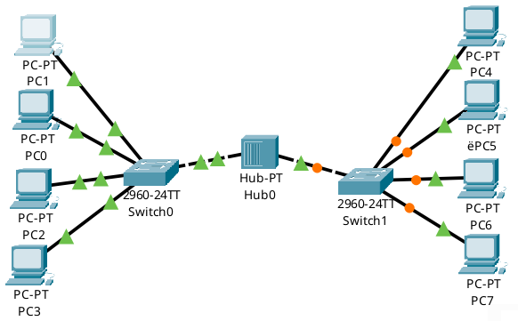
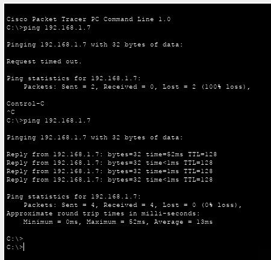
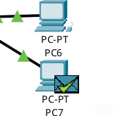

# Домашнее задание: Построение локальной сети

## Топология
Сеть состоит из 8 компьютеров, 2 коммутаторов 2960 и 1 концентратора (Hub). 
Все узлы расположены в общей подсети `192.168.1.0/24`.

### 1. Схема сети

### 2. Консольный Ping

### 3. Отправка ICMP-пакета в режиме симуляции
